# Awesome Business Process Automation (BPA) ⚙️🚀

<p align="center">
  
</p>

<p align="center">
  <a href="https://github.com/ishandutta2007/Awesome-Awesome-Awesome"></a>
  <a href="https://discord.gg/jc4xtF58Ve"></a>
  <a href="https://github.com/ishandutta2007/Awesome-Business-Process-Automation-BPA/stargazers"></a>
  <a href="https://github.com/ishandutta2007/Awesome-Business-Process-Automation-BPA/network/members"></a>
  <a href="https://github.com/ishandutta2007/Awesome-Business-Process-Automation-BPA/blob/main/LICENSE"></a>
  <a href="https://github.com/ishandutta2007"></a>
</p>

---

## 📌 Top Business Process Automation (BPA) Ecosystem

> **Curated list of enterprise SaaS platforms, open-source workflow orchestration engines, BPMN 2.0 modelers, and decision automation systems.**

Welcome to the definitive directory for **Business Process Automation (BPA)**, **Digital Process Automation (DPA)**, and **Enterprise Workflow Orchestration**. Whether you are looking for an enterprise low-code suite, an agile event-driven microservices orchestrator, or a self-hosted BPMN 2.0 execution engine, this guide benchmarks leading SaaS products and open-source GitHub repositories.

---

## 📑 Table of Contents
- [📊 Sector Overview & Market Dynamics](#-sector-overview--market-dynamics)
- [☁️ SaaS & Hosted Enterprise Platforms](#️-saas--hosted-enterprise-platforms)
- [💻 Open-Source GitHub Projects](#-open-source-github-projects)
- [🛠️ Architectural Guidance: Choosing Your Stack](#️-architectural-guidance-choosing-your-stack)
- [🤝 How to Contribute](#-how-to-contribute)
- [💖 Support](#-support)
- [⭐ Star History](#-star-history)
- [📄 Disclaimer](#-disclaimer)

---

## 📊 Sector Overview & Market Dynamics

The global **Business Process Automation (BPA)** and Workflow Automation market is estimated at **$17 billion to $22 billion**, expanding at a robust **10.6% to 18.4% CAGR** toward **$50+ billion** over the next decade as enterprises embrace agentic AI, intelligent document processing, and low-code orchestration. 

Structurally, the sector exhibits **moderate-to-high fragmentation** across specialized domain tools, regional system integrators, and niche workflow SaaS, yet displays **heavy oligopolistic concentration** at the Fortune 500 enterprise core—dominated by hyper-scale ecosystem leaders like Microsoft, ServiceNow, and IBM that deliver end-to-end mission-critical digital operating backbones.

---

## ☁️ SaaS & Hosted Enterprise Platforms

The table below lists category-defining commercial BPA and workflow orchestration solutions, sorted in descending order by **Company Size (Market Capitalization / Estimated Enterprise Valuation)**.

| Platform / Vendor | Starting Price (Specific Tier) | Free Tier Limits / Free Trial Limits | Company Size (Market Cap / Valuation) | Key BPA Capabilities & Highlights |
| :--- | :--- | :--- | :--- | :--- |
| **[Microsoft Power Automate](https://powerautomate.microsoft.com/)** | **$15/user/month** (Power Automate Premium plan; Process plan at **$150/bot/month**) | **Free Forever plan** bundled with Microsoft 365 licenses (restricted strictly to Standard Connectors, attended desktop automation, and 6,000 requests/day profile; no premium connectors). **30-day free trial** of Power Automate Premium with full connector access. | **~$3.9 Trillion** (Market Cap) | 1,000+ connectors, AI Builder, cloud flows, and attended/unattended desktop RPA integrated natively with Microsoft 365, Teams, and Azure. |
| **[IBM Cloud Pak for Business Automation](https://www.ibm.com/products/cloud-pak-for-business-automation)** | **~$1,500/month** (entry deployment via cloud/PVU consumption licensing; enterprise Passport Advantage pricing) | **No Free Forever plan**. Offers a **30-day hosted cloud trial** (pre-configured interactive sandbox for document processing, workflow modeling, and ODM decision rules; restricted to non-production evaluation). | **~$220 Billion** (Market Cap) | Comprehensive enterprise suite integrating IBM Workflow (BPM), Operational Decision Manager (ODM), Content Services, and AI-driven automation. |
| **[ServiceNow](https://www.servicenow.com/)** | **~$70–$100/user/month** (ITSM/App Engine Starter agent seat baseline, billed annually; custom enterprise agreement) | **No Free Forever production plan**. Offers a **Developer Program instance** (personal development instance sandbox; hibernates after 10 days of inactivity, non-production use only). | **~$140 Billion** (Market Cap) | Comprehensive enterprise digital operating system featuring Flow Designer, App Engine Studio, Integration Hub, and end-to-end IT/HR/Customer workflows. |
| **[UiPath](https://www.uipath.com/)** | **$25/user/month** (Basic Cloud plan; Automation Developer plan from **$420/month**) | **Free Forever Community Edition** (limited to 2 Studio Web/Desktop seats, 1 attended robot, and 1 unattended robot on shared community cloud; for individuals and non-commercial/small-business learning). **60-day Enterprise cloud trial**. | **~$6.9 Billion** (Market Cap) | Industry standard for Robotic Process Automation (RPA), attended and unattended digital workers, Document Understanding, and Process Mining. |
| **[Pega](https://www.pega.com/)** | **~$97/user/month** (standard platform seat baseline; typical enterprise subscription agreements require **$200,000+/year** initial commitment) | **No Free Forever production plan**. Offers a **30-day free trial** of Pega Cloud / Community Edition (restricted to sandbox evaluation, sample blueprints, and limited storage; non-production). | **~$5.7 Billion** (Market Cap) | AI-powered decisioning engine, 1:1 Customer Engagement, Case Management, and deep regulatory/compliance workflow automation. |
| **[Appian](https://www.appian.com/)** | **~$75/user/month** (Standard User tier; typical minimum annual contract commitment starts at **$84,000+/year**) | **No Free Forever production plan**. Offers a **14-day free Community Edition trial** (personal sandbox environment for low-code process design, Appian Data Fabric testing, and AI skills experimentation). | **~$2.7 Billion** (Market Cap) | Low-code BPA leader combining unified Data Fabric, native process mining, visual workflow automation, and enterprise governance. |
| **[Nintex](https://www.nintex.com/)** | **$1,300/month** (Pro plan starting tier covering unlimited users and up to 20 active automated workflows) | **No Free Forever plan**. Offers a **30-day fully functional free trial** (unlimited workflow runs within the sandbox environment, document generation, and digital forms testing). | **~$2.0 Billion** (Private Equity Valuation) | Accessible no-code/low-code workflow engine, Nintex K2 Five integration, digital forms, e-signatures, and automated document generation. |
| **[Camunda Cloud (Camunda 8 SaaS)](https://camunda.com/)** | **~$50,000/year** (Enterprise SaaS baseline, or usage-based tier starting around **$0.80 per 1,000 process instances** beyond base entitlements) | **Free Forever plan** (up to 5 developer users, restricted to non-production modeling and low task throughput). Offers a **30-day SaaS trial** with full Zeebe workflow execution and 10,000 process instances. | **~$1.0+ Billion** (Private Valuation) | Managed cloud orchestration powered by the cloud-native Zeebe engine, native BPMN 2.0 execution, DMN business decision tables, and gRPC microservice connectors. |
| **[Bizagi](https://www.bizagi.com/)** | **~$165/user/month** (~$1,990/user/year entry tier commitment for Bizagi Studio/Cloud execution) | **Free Forever Bizagi Modeler desktop edition** (unlimited standalone desktop BPMN modeling and documentation; cloud execution requires paid license). **30-day free trial** of Bizagi Studio Cloud. | **~$145 Million** (Estimated Valuation) | Low-code BPMN platform prioritizing model-driven workflow execution, process simulation, and agile corporate digital transformation. |
| **[Kissflow](https://kissflow.com/)** | **$1,500/month** (Corporate entry tier, or simple workflow edition starting at **$15/user/month** with 50-user minimum) | **No Free Forever plan**. Offers a **14-day free trial** (access to drag-and-drop process builder, pre-built workflow templates, and form design; capped at 10 trial users). | **~$50–$90 Million** (Estimated Valuation) | Intuitive visual workflow automation designed for non-technical business users, procurement tracking, HR approvals, and internal service desks. |

---

## 💻 Open-Source GitHub Projects

The following open-source workflow orchestration engines, BPMN execution runtimes, and automation platforms are ranked in descending order by **GitHub Star Count**. Beside each project name is a live star badge linking directly to the repo's stargazers page.

| Project & Repository | GitHub Stars Badge | License | Core Focus & BPA Description |
| :--- | :---: | :--- | :--- |
| **[n8n](https://github.com/n8n-io/n8n)** | [](https://github.com/n8n-io/n8n/stargazers) | Sustainable Use License | **Fair-code node-based workflow automation**. Over 400+ native connectors, visual flowchart editor, custom JavaScript/Python execution nodes, and advanced AI-agent capabilities. Ideal for API orchestration, webhook processing, and business task automation. |
| **[Apache Airflow](https://github.com/apache/airflow)** | [](https://github.com/apache/airflow/stargazers) | Apache-2.0 | **Programmatic workflow authoring via Python DAGs**. The gold standard for data engineering pipelines, batch job scheduling, and ML workflows. Best suited for backend data pipelines and infrastructure orchestration rather than human-in-the-loop task routing. |
| **[Conductor](https://github.com/conductor-oss/conductor)** | [](https://github.com/conductor-oss/conductor/stargazers) | Apache-2.0 | **Microservices orchestration engine** originally built by Netflix. Designed for high-throughput distributed architectures, JSON-defined workflows, task queues, and human task approvals with cross-language worker SDKs. |
| **[Kestra](https://github.com/kestra-io/kestra)** | [](https://github.com/kestra-io/kestra/stargazers) | Apache-2.0 | **Modern declarative event-driven orchestrator**. YAML-based workflow definitions, embedded code runners, rich web UI, and real-time execution topologies for business and data pipeline automations. |
| **[Activepieces](https://github.com/activepieces/activepieces)** | [](https://github.com/activepieces/activepieces/stargazers) | MIT | **No-code open-source Zapier alternative**. Features intuitive UI flow building, hundreds of pre-packaged business integrations, TypeScript pieces framework, and easy self-hosting via Docker. |
| **[Prefect](https://github.com/PrefectHQ/prefect)** | [](https://github.com/PrefectHQ/prefect/stargazers) | Apache-2.0 | **Modern Python workflow coordinator**. Code-as-workflows paradigm using native Python decorators, dynamic task mapping, state observers, scheduling, and resilient orchestration for backend business operations. |
| **[Node-RED](https://github.com/node-red/node-red)** | [](https://github.com/node-red/node-red/stargazers) | Apache-2.0 | **Visual low-code flow builder for IoT and integration**. Browser-based flow editing, lightweight Node.js event-driven runtime, and an expansive ecosystem of community nodes for rapid API and device automation. |
| **[Temporal](https://github.com/temporalio/temporal)** | [](https://github.com/temporalio/temporal/stargazers) | MIT | **Durable execution platform and code-first orchestration engine**. Workflows are written directly in Go, TypeScript, Java, or Python without diagrams. Offers automatic retries, heartbeat checks, signals, and persistent execution state that survives server restarts. Used by Stripe, Netflix, and Datadog. |
| **[Windmill](https://github.com/windmill-labs/windmill)** | [](https://github.com/windmill-labs/windmill/stargazers) | AGPL-3.0 | **Developer platform for scripts, workflows, and internal UIs**. Super-fast runtime built with Rust, supporting Python, TypeScript, Go, and Bash scripts transformed instantly into shareable workflows and internal tools. |
| **[Automatisch](https://github.com/automatisch/automatisch)** | [](https://github.com/automatisch/automatisch/stargazers) | AGPL-3.0 | **Privacy-focused open-source business automation**. Lets teams automate repetitive cross-service tasks without storing company data on third-party cloud infrastructure (GDPR/HIPAA friendly). |
| **[Activiti](https://github.com/Activiti/Activiti)** | [](https://github.com/Activiti/Activiti/stargazers) | Apache-2.0 | **Lightweight enterprise Business Process Management (BPM) suite**. The seminal open-source Java BPMN 2.0 engine, offering form engines, task lists, and REST interfaces for embedding into enterprise Java stacks. |
| **[bpmn-js](https://github.com/bpmn-io/bpmn-js)** | [](https://github.com/bpmn-io/bpmn-js/stargazers) | MIT | **The web standard BPMN 2.0 diagram viewer and modeler**. Embedded directly in web applications to render, inspect, and edit executable BPMN diagrams in JavaScript. Backing viewer for Camunda, Flowable, and many enterprise tools. |
| **[Flowable](https://github.com/flowable/flowable-engine)** | [](https://github.com/flowable/flowable-engine/stargazers) | Apache-2.0 | **Compact, lightning-fast BPMN, DMN, and CMMN process engine**. Highly customizable Java workflow engine featuring process, case, decision, form, and content management microservices. |
| **[Apache Camel](https://github.com/apache/camel)** | [](https://github.com/apache/camel/stargazers) | Apache-2.0 | **Versatile enterprise integration pattern (EIP) framework**. Over 300 components to connect databases, message brokers, protocols, and SaaS platforms into structured, resilient routing pipelines. |
| **[Camunda 8 (Zeebe)](https://github.com/camunda/camunda)** | [](https://github.com/camunda/camunda/stargazers) | Apache-2.0 | **Next-generation cloud-native distributed workflow engine**. Powered by the partitionable Zeebe broker for high-throughput, fault-tolerant BPMN 2.0 process orchestration across distributed microservices. |
| **[Camunda Platform 7](https://github.com/camunda/camunda-bpm-platform)** | [](https://github.com/camunda/camunda-bpm-platform/stargazers) | Apache-2.0 | **Production-grade BPMN 2.0 & DMN engine**. Battle-tested enterprise workhorse for embedded Java Spring Boot or standalone shared workflow automation. Official enterprise support maintained through 2030. |
| **[jBPM](https://github.com/kiegroup/jbpm)** | [](https://github.com/kiegroup/jbpm/stargazers) | Apache-2.0 | **Flexible business automation suite from KIE / Red Hat**. Comprehensive support for BPMN 2.0 modeling, Drools business rules integration, dynamic case management, and form generation. |
| **[ProcessMaker](https://github.com/ProcessMaker/processmaker)** | [](https://github.com/ProcessMaker/processmaker/stargazers) | AGPL-3.0 | **Open-source low-code workflow engine and BPM software**. Drag-and-drop form designer, BPMN 2.0 diagram canvas, and document approval workflows trusted by thousands of organizations worldwide. |
| **[Operaton](https://github.com/operaton/operaton)** | [](https://github.com/operaton/operaton/stargazers) | Apache-2.0 | **Community-driven open-source continuation of Camunda 7**. Developed by an independent community to preserve and extend the classic embedded Java BPMN/DMN engine architecture. |
| **[dmn-js](https://github.com/bpmn-io/dmn-js)** | [](https://github.com/bpmn-io/dmn-js/stargazers) | MIT | **Decision Model and Notation (DMN 1.3) web modeler**. Interactive web-based rendering and editing of business decision tables, literal expressions, and decision requirements graphs (DRD). |
| **[Bonita Engine](https://github.com/bonitasoft/bonita-engine)** | [](https://github.com/bonitasoft/bonita-engine/stargazers) | GPL-2.0 | **Extensible open-source digital process automation platform**. Pairs an execution engine with UI designer and REST APIs to deploy custom enterprise process portals. |
| **[Drools](https://github.com/kiegroup/drools)** | [](https://github.com/kiegroup/drools/stargazers) | Apache-2.0 | **The leading open-source Business Rules Management System (BRMS)**. Advanced forward/backward chaining inference engine utilizing the Rete and Phreak algorithms for complex decision automation. |
| **[Apache ServiceMix](https://github.com/apache/servicemix)** | [](https://github.com/apache/servicemix/stargazers) | Apache-2.0 | **Enterprise-class open-source ESB**. Integrates Apache ActiveMQ, Camel, CXF, and Karaf for multi-protocol enterprise service bus integration and mediation. |
| **[Kogito](https://github.com/kiegroup/kogito-runtimes)** | [](https://github.com/kiegroup/kogito-runtimes/stargazers) | Apache-2.0 | **Cloud-native business automation platform for Quarkus and Spring Boot**. Optimized for Kubernetes serverless microservices, compile-time DMN evaluation, and instant startup times. |

---

## 🛠️ Architectural Guidance: Choosing Your Stack

```
               ┌────────────────────────────────────────────────────────┐
               │    What is your core orchestration requirement?        │
               └──────────────────────────┬─────────────────────────────┘
                                          │
                  ┌───────────────────────┴───────────────────────┐
                  ▼                                               ▼
         [ Visual / BPMN Native ]                        [ Code-First / Durable ]
                  │                                               │
        ┌─────────┴─────────┐                           ┌─────────┴─────────┐
        ▼                   ▼                           ▼                   ▼
  Commercial SaaS      Self-Hosted OSS             Commercial SaaS      Self-Hosted OSS
  - Camunda Cloud      - Camunda 7 / Operaton      - Temporal Cloud     - Temporal
  - Power Automate     - Flowable                  - AWS Step Functions - Conductor
  - Pega / Appian      - Activiti / ProcessMaker   - Prefect Cloud      - Windmill / Kestra
```

* **Visual Modeling & Business Alignment (BPMN 2.0)**: Choose **Camunda 7/8**, **Flowable**, or **ProcessMaker** when business analysts, compliance officers, and developers need to collaborate on executable process diagrams.
* **Code-First Microservices Orchestration**: Choose **Temporal**, **Conductor**, or **Kestra** when engineering velocity, version-controlled code, and durable state handling without graphical overhead are paramount.
* **Rapid API & SaaS Glue Automation**: Choose **n8n**, **Activepieces**, or **Windmill** for agile, low-code integration pipelines with minimal setup overhead.
* **Desktop & Legacy UI Automation (RPA)**: Pair your workflow engine with **UiPath** or **Microsoft Power Automate** for surface-level robotic automation against legacy systems lacking APIs.

---

## 🤝 How to Contribute

Contributions are warmly welcomed! Help make this curated directory the best resource on the web:

1. **Fork** this repository.
2. Add your tool to either the **SaaS Table** or the **Open-Source Table** (maintaining sorting criteria).
3. Ensure all links, pricing entries, free tier parameters, and star badges match the documented schema.
4. Submit a **Pull Request** with a concise description of why the tool should be added.

---

## 💖 Support

If you find this curated Business Process Automation repository helpful, please consider supporting the project:

- ⭐ **Star** this repository to help others discover it on GitHub!
- 🍴 **Fork** and contribute new workflow tools, engines, or benchmarks.
- 📢 **Share** this list with colleagues, engineering leads, and DevOps/BPA teams.
- ☕ **Sponsor**: Buy us a coffee and back open-source curation on our [GitHub Sponsors Dashboard](https://github.com/sponsors/ishandutta2007).

Thank you for being part of the open automation community! ❤️

---

## ⭐ Star History

[](https://star-history.dera.page/#ishandutta2007/Awesome-Business-Process-Automation-BPA&type=date&legend=top-left)

---

## 📄 Disclaimer

* This repository is an independent, community-maintained collection and is not directly affiliated with, sponsored, or endorsed by any of the listed companies or foundations.
* Product names, logos, brands, and registered trademarks belong to their respective holders.
* Pricing and licensing models frequently evolve; verify current rates directly on vendor websites.

---

<p align="center">
  <b>Built with ❤️ for process architects, automation engineers, and open-source workflow builders.</b>
</p>
